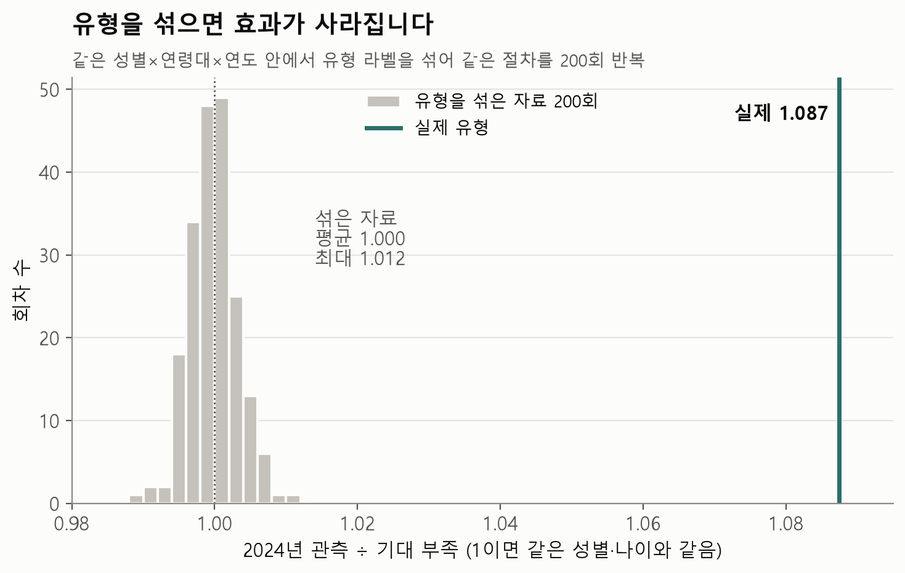
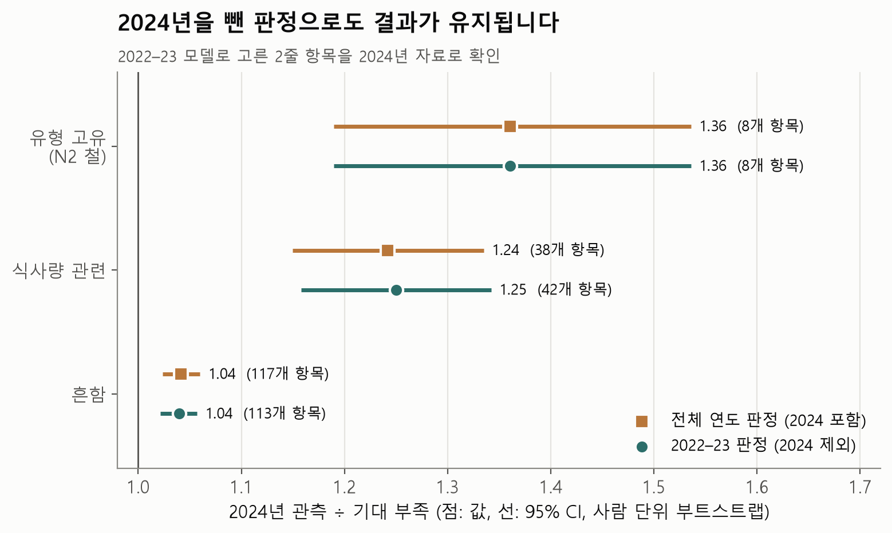
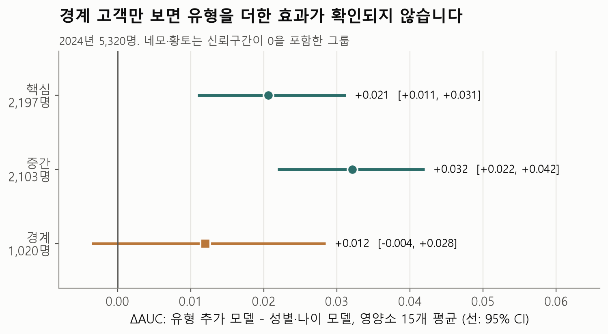

# 12유형 → 부족 영양소 추가 검증 결과

2026-11-05 · 최지연

## 결론

**모델, 12유형, 화면 규칙은 바꾸지 않아도 됩니다.** 판정 재검증과 라벨 섞기 대조는 미리 정한 기준을 통과했습니다. 경계 고객은 핵심 고객과 차이가 확인되지 않았지만, 경계 고객만 보면 유형이 예측을 더 낫게 한다는 근거도 확인되지 않았습니다.

| 검증 | 결과 | 판정 |
|---|---|---|
| 라벨 섞기 | 실제 O/E 1.087, 섞은 자료 평균 1.000 (최대 1.012) | 통과 |
| 판정 재검증 | 유형 고유 1.36, 식사량 관련 1.25, 흔함 1.04 | 통과 |
| 경계 AUC | 핵심 − 경계 ΔAUC 차이 +0.009, 95% CI −0.010~+0.028 | 차이 확인 안 됨 |

## 방법과 재현 확인

- 분석 코드는 `추가검증.py`, 그림 코드는 `그림.py`입니다. 판정 기준은 결과를 보기 전에 분석 코드 첫머리에 적었습니다.
- 입력은 15,062명이고, 2022–23년으로 학습한 뒤 2024년 5,320명으로 평가했습니다.
- 먼저 기존 값을 재현했습니다. 판정표, ΔAUC(칼슘 +0.040 등), 유의 13/15, O/E 1.087, 판정별 1.36 / 1.24 / 1.04가 모두 같았습니다. 유형 인원만 N1·O2에서 1명씩 다른데, 기존 문서에 기록된 15,060명과 15,062명의 차이입니다.

## 1. 라벨 섞기 대조

같은 성별×연령대×연도 안에서 유형 라벨을 섞고, 같은 절차를 200회 반복했습니다.

| 지표 | 실제 | 섞은 자료 평균 | 섞은 자료 범위 | 기준 |
|---|---:|---:|---:|---|
| (나)안 O/E | 1.087 | 1.000 | 0.988~1.012 | 평균 0.98~1.02, 실제 > 최댓값: 통과 |
| 평균 ΔAUC | +0.0242 | −0.0040 | −0.0081~−0.0009 | 평균 절댓값 < 0.005, 실제 > 최댓값: 통과 |
| 2줄 항목 수 | 163 | 148.1 | 134~159 | 참고 |

- **말할 수 있는 것:** 절차 자체가 없는 신호를 만들지는 않았고, 실제 유형의 신호는 무작위 라벨보다 큽니다.
- **말할 수 없는 것:** 12유형이 다른 나눔보다 낫다는 뜻은 아닙니다. 사람이 정한 규칙 16개도 AUC 0.630으로 12유형 0.632와 비슷합니다.
- **영양소별:** 순열 p값 BH 보정 기준으로 비타민 D를 뺀 14개가 유의했습니다(200회라 p 최솟값은 0.005). 비타민 E는 무작위 라벨보다 낫지만 성별·나이 모델보다 낫다는 근거는 없으므로(ΔAUC CI가 0 포함), 기존 "13/15"와 공통 안내 결정을 유지합니다.

## 2. 판정 재검증

판정을 2022–23년 자료만으로 다시 만들고, 같은 기간 모델로 고른 2줄 항목을 2024년에서 확인했습니다.

| 판정 | 항목 수 | 2024 O/E | 95% CI (사람 단위) | 기존 값 |
|---|---:|---:|---:|---:|
| 전체 | 163 | 1.087 | 1.067~1.108 | 1.087 |
| 유형 고유 | 8 | 1.361 | 1.190~1.536 | 1.361 |
| 식사량 관련 | 42 | 1.250 | 1.158~1.342 | 1.242 |
| 흔함 | 113 | 1.040 | 1.021~1.057 | 1.042 |

- **유지됨:** 세 판정 모두 CI 하한이 1보다 큽니다. 공통 8개도 2022–23 자료에서 그대로입니다(마그네슘 49.6%).
- **"유형 고유 1.36"의 범위:** 8개 항목이 모두 **N2의 철**입니다. 유형 고유 판정이 일반적으로 강하다는 뜻이 아니라 N2 철 하나의 결과로 설명해야 합니다.
- **순서의 한계:** 유형 고유와 식사량 관련의 CI가 겹쳐, 유형 고유가 더 높다고 단정할 수는 없습니다.
- **판정 변화:** 유형 고유는 3건에서 1건으로 줄었습니다(N2 인, S1 인은 식사량 관련으로 이동). 식사량 관련은 8건 중 7건이 유지되고(S1 철 빠짐) 7건이 새로 들어왔습니다.
- **새로 들어온 항목:** 2024년 비가 약한 것도 있습니다(S2 단백질 1.02, S2 인 0.96).

서비스 문구는 전체 연도 판정을 그대로 쓰고, 이 재계산은 검증 숫자로만 씁니다.

## 3. 경계 AUC

경계 여유는 `bigskyyang/analysis/07_boundary.py`와 같은 식이고, 대분류와 세부 중 작은 값입니다. 경계 10% 미만, 중간 10~30%, 핵심 30% 이상으로 나눴습니다.

| 구분 | 인원 | AUC | 성별·나이 모델 AUC | ΔAUC (95% CI) | 보정 오차 평균 (최대) |
|---|---:|---:|---:|---:|---:|
| 핵심 | 2,197 | 0.633 | 0.613 | +0.021 (0.011~0.031) | 1.8%p (4.6%p) |
| 중간 | 2,103 | 0.637 | 0.605 | +0.032 (0.022~0.042) | 1.0%p (2.8%p) |
| 경계 | 1,020 | 0.613 | 0.601 | +0.012 (−0.004~+0.028) | 1.2%p (3.5%p) |

핵심 − 경계 차이는 AUC +0.021 (95% CI −0.004~+0.049), ΔAUC +0.009 (−0.010~+0.028)입니다.

- **차이:** 핵심과 경계의 차이는 확인되지 않았습니다. 경계 인원이 적어 차이가 없다고 단정할 수도 없습니다.
- **경계 고객의 확률:** 보정 오차가 최대 3.5%p라 "10명 중 N명"은 경계 고객 집단에도 쓸 수 있습니다.
- **주의:** 경계 고객만 보면 ΔAUC CI가 0을 포함합니다. 유형이 이들의 예측을 더 낫게 한다는 근거는 확인되지 않았습니다.
- **기존 수치와 다름:** 기존 문서의 핵심 2,343 / 중간 2,010 / 경계 967명, 평균 AUC 0.637 / 0.639 / 0.623, 철 0.706 / 0.668은 재현되지 않았습니다. 원본 `08_군집경계_진단` 코드가 저장소에 없어, 나눈 기준이 다른 것으로 보이지만 확인하지는 못했습니다.

## 한계

- 유형 경계는 2024년 응답까지 포함해 학습했습니다. 다만 군집 입력은 생활습관뿐이고 부족 여부는 쓰지 않았습니다.
- 모델 설정은 08번이 고른 값을 문서에서 옮겼고, 튜닝을 다시 하지는 않았습니다. ΔAUC가 기존 값과 같아 설정은 일치한다고 봅니다.
- CI는 사람 단위 부트스트랩이고, 층·조사구 같은 복합표본 설계는 반영하지 않았습니다.
- 경계 구간의 기준값은 대천님 경계 분석의 구간을 참고해 정했습니다.

## 보고서에 쓸 수 있는 문장

> 유형 라벨을 무작위로 섞으면 안내 항목의 2024년 O/E는 1.00으로 사라졌고, 실제 값은 1.09였습니다. 판정을 2022–23년 자료만으로 다시 만들어도 유형 고유 1.36배(N2 철), 식사량 관련 1.25배, 흔함 1.04배로 유지됐습니다. 경계 고객은 핵심 고객과 차이가 확인되지 않았지만, 경계 고객만 보면 유형을 더한 효과가 확인되지 않아 개인 판단은 맞춤 예측 단계에서 합니다.
