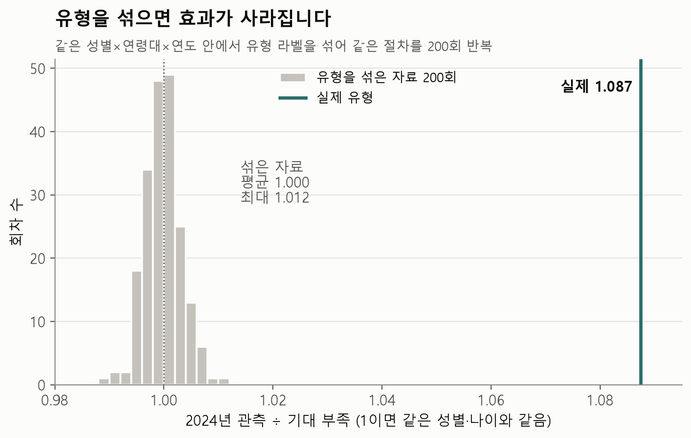
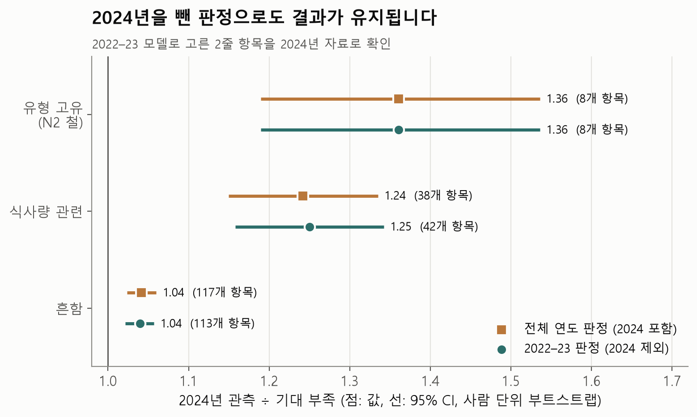
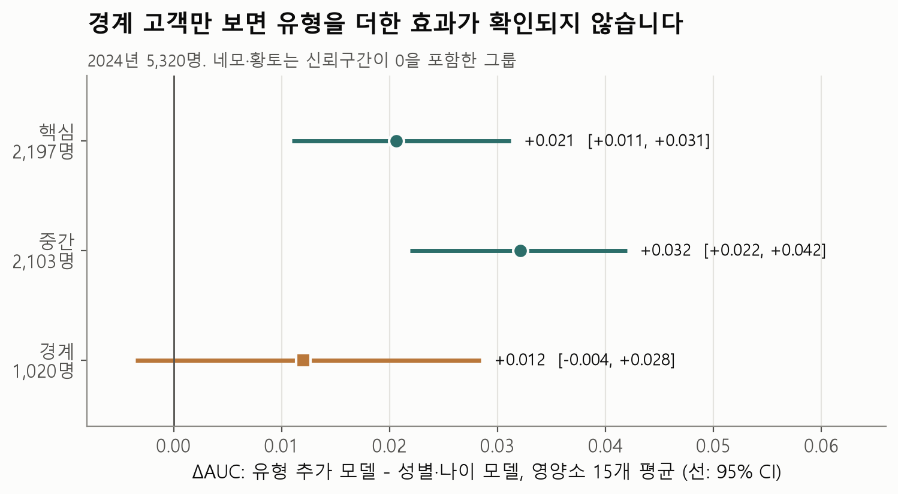

# 12유형 → 부족 영양소 머신러닝 검증 종합

2026-11-05 · 최지연

## 결론

**12유형과 부족 영양소 머신러닝은 "대략 어느 유형이고, 그 유형에 어떤 부족 경향이 있는지" 안내하는 용도로 적절합니다.** 다만 자연적으로 존재하는 집단을 찾았다거나, 개인의 부족을 정확히 맞힌다고 말할 수는 없습니다.

모델, 12유형, 화면 규칙은 바꾸지 않아도 됩니다.

| 질문 | 답 | 핵심 근거 |
|---|---|---|
| 뚜렷한 집단이 있나? | 확인되지 않음 | 실루엣이 가짜 자료를 넘지 못함 |
| 유형이 안정적인가? | 같은 응답은 항상 같고, 경계는 움직임 | 재학습 ARI 0.697, 안내 변화 약 8% |
| 유형이 영양 안내에 쓸모 있나? | 있지만 효과가 작음 | AUC +0.024, 15개 중 13개 유의 |
| 새 연도에도 맞나? | 맞음 | 2024 O/E 1.087 |
| 우연이나 절차가 만든 결과인가? | 아님 | 유형을 섞으면 O/E 1.000 |
| 개인을 구분할 수 있나? | 같은 유형·성별·연령대 안에서는 못 함 | 입력이 같으면 같은 확률 |

## 전체 흐름

1. **군집화:** 성인 15,062명의 생활습관 7개 변수로 PCA와 K-Medoids를 적용해 대분류 4개 × 세부 3개 = 12유형을 만들었습니다. 정답 라벨이 없는 비지도 학습입니다.
2. **부족 확률 예측:** 유형, 성별, 연령대를 넣어 영양소 15개의 부족 확률을 예측합니다. 2022–23년으로 학습하고 2024년으로 평가했습니다.
3. **화면 표시:** 1줄은 공통 영양소 8개, 2줄은 그 외에 이 유형에서 살펴볼 영양소입니다. 2줄은 확률 0.5 이상이거나, 같은 성별·나이의 1.2배 이상이면서 10명 중 3명 이상일 때 표시합니다.

## 단계별 검증 결과

### 1. 군집이 믿을 만한가

| 검증 | 결과 | 의미 |
|---|---|---|
| 구조 유무 (대분류 실루엣) | 실제 0.163, 가짜 자료 평균 0.183 / 0.207 | 가짜 자료보다 높지 않음 |
| 구조 유무 (12유형 실루엣) | 실제 0.100, 가짜 자료 평균 0.096 / 0.117 | 가짜 자료와 비슷함 |
| 같은 자료에서 시드 변경 | ARI 1.000 (시작 10회) | 같은 자료면 같은 결과 |
| 표본을 바꿔 재학습 | ARI 0.697 (최소 0.453) | 경계가 움직임 |
| 2022–23 학습 → 2024 배정 | ARI 0.738 | 새 연도에도 어느 정도 유지됨 |
| 재학습 때 바뀌는 사람 | 유형 19.1%, 영양 안내 약 8% | 유형보다 안내가 더 안정적임 |
| 웹 재배정 | 15,062명 100% 일치 | 웹 계산이 파이썬과 같음. 모델 성능은 아님 |

**정리:** 12유형은 발견한 집단이 아니라 습관을 이해하기 쉽게 나눈 구분입니다. ARI 0.945는 시드만 바꾼 k 비교 값이므로 k 선택 근거로만 씁니다. 간격 4 SD 이상의 강한 덩어리는 없어 보이지만, 약한 구조까지 없다고 단정할 수는 없습니다.

### 2. 유형이 예측에 도움이 되는가

| 비교 대상 | 결과 | 의미 |
|---|---|---|
| 성별·나이 모델 | ΔAUC 평균 +0.024, 13/15 유의 (비타민 D·E 제외) | 도움이 되지만 작음 |
| 유형을 섞은 자료 200회 | 평균 ΔAUC −0.004 (최대 −0.001), 실제 +0.024 | 우연보다 큼 |
| 사람이 정한 규칙 16개 | AUC 0.630 vs 12유형 0.632 | 규칙보다 낫다고 말할 수 없음 |
| 7개 유형 안 | AUC 0.635 vs 12유형 0.632 | 영양 설명력은 비슷함 |
| 개인 모델 (13개 영양소) | 성별·나이 0.604 → 유형 0.631 → 개인 0.659 | 유형은 중간 단계 |

- 영양소별 AUC는 0.56~0.70이라 개인을 정확히 가르는 수준은 아닙니다.
- 확률 오차는 10분위 기준 최대 1.7%p라 "10명 중 N명"으로 보여 줘도 됩니다.
- 평소 식사일과 에너지 범위를 제한한 민감도 분석에서 안내 일치율은 98.7~99.4%입니다.
- 칼륨은 13개에 들어가지만 민감도 분석에서 판정이 뒤집혀, 비타민 D·E와 함께 공통 안내로만 씁니다.

### 3. 화면에 보여 주는 항목이 새 연도에도 맞는가

2022–23 자료로 항목을 고르고, 2024년에 같은 성별·나이보다 얼마나 더 부족한지 확인했습니다.

| 항목 | 개수 | 2024 O/E | 95% CI |
|---|---:|---:|---:|
| 전체 | 163 | 1.087 | 1.067~1.108 |
| 유형 고유 ("이 유형에서 특히 많아요") | 8 | 1.361 | 1.190~1.536 |
| 식사량 관련 ("식사량 점검이 먼저예요") | 42 | 1.250 | 1.158~1.342 |
| 흔함 ("같은 성별·나이대에서 흔해요") | 113 | 1.040 | 1.021~1.057 |

- 판정별 값은 판정도 2022–23 자료만으로 다시 만든 결과입니다. 기존 값 1.36 / 1.24 / 1.04와 거의 같습니다.
- 유형 고유 8개는 모두 N2의 철입니다. 판정 재계산에서 유형 고유는 3건에서 1건으로 줄어, 이 판정은 자료에 민감합니다.
- 유형 고유와 식사량 관련은 신뢰구간이 겹쳐, 유형 고유가 더 높다고 단정할 수 없습니다.
- 유형을 섞으면 O/E는 평균 1.000 (0.988~1.012)으로 사라집니다.

### 4. 유형 경계에 있는 사람에게도 통하는가

| 구분 | 인원 | AUC | ΔAUC (95% CI) | 확률 오차 최대 |
|---|---:|---:|---:|---:|
| 핵심 | 2,197 | 0.633 | +0.021 (0.011~0.031) | 4.6%p |
| 중간 | 2,103 | 0.637 | +0.032 (0.022~0.042) | 2.8%p |
| 경계 | 1,020 | 0.613 | +0.012 (−0.004~+0.028) | 3.5%p |

- 세 그룹은 12개 유형의 사람을 섞어 경계 여유로 나눈 것입니다. 군집 하나의 안을 비교한 것은 아닙니다.
- 핵심 − 경계 ΔAUC 차이는 +0.009 (95% CI −0.010~+0.028)로 확인되지 않았습니다. 경계 고객에게 더 못한다는 근거가 없다는 뜻이고, 인원이 적어 차이가 없다고 단정할 수는 없습니다.
- 경계 고객의 집단 확률 오차는 작아 "10명 중 N명" 안내에는 쓸 수 있습니다.
- 경계 고객만 보면 유형을 더한 효과가 확인되지 않습니다.

### 5. 군집 사이의 차이

군집 사이의 경계는 뚜렷하지 않지만, 부족 양상은 군집마다 다릅니다. N2·S1·O1은 철·인·단백질·아연이 같은 성별·나이보다 1.2~1.7배 더 부족하고, A3·O2·N3는 대부분 영양소에서 0.67~0.9배로 덜 부족합니다. 위의 O/E와 라벨 섞기 결과가 이 차이를 뒷받침하므로 추가 비교는 필요하지 않습니다.

## 말할 수 있는 것과 없는 것

| 말할 수 있음 | 말할 수 없음 |
|---|---|
| 생활습관을 이해하기 쉽게 나눈 재현 가능한 구분이다 | 한국인은 12개 유형으로 나뉜다 |
| 같은 응답이면 같은 유형이 나온다 | 표본이 바뀌어도 유형이 안정적이다 |
| 유형은 성별·나이에 더해 부족 경향 정보를 조금 준다 | 12유형이 사람이 정한 규칙보다 낫다 |
| 고른 항목은 2024년에도 1.09배 더 부족했다 | 그 유형의 개인이 실제로 부족하다 |
| 경계 고객이 더 나쁘다는 근거는 없다 | 경계 고객에게도 유형이 똑같이 도움이 된다 |
| 습관과 부족 사이에 관련이 있다 | 이 습관 때문에 부족하다 |

## 바꿀 수 없는 한계

- 식사 기록이 하루치(24시간 회상)이고 자기 보고입니다.
- 영양제 섭취가 빠져 있습니다.
- 비타민 D·E·칼륨·식이섬유는 충분섭취량 기준이라 미만이어도 부족하다고 단정할 수 없습니다.
- 유형 경계와 PCA는 2024년 응답까지 포함해 학습했습니다. 다만 군집 입력은 생활습관뿐이고 부족 여부는 쓰지 않았습니다.
- 신뢰구간은 사람 단위 부트스트랩이고, 층·조사구 같은 복합표본 설계는 반영하지 않았습니다.

## 발표 문장

> 12유형은 자연적으로 존재하는 집단이 아니라 생활습관을 이해하기 쉽게 나눈 구분입니다. 같은 응답이면 같은 유형이 나오지만, 표본을 바꿔 다시 학습하면 경계가 움직입니다(ARI 약 0.7). 그래도 2022–23년 자료로 고른 안내 항목은 2024년에도 같은 성별·나이보다 1.09배 더 부족했고, 유형을 무작위로 섞으면 이 차이가 사라졌습니다. 효과가 크지 않아 유형은 대략적인 경향을 안내하는 데 쓰고, 개인 판단은 맞춤 예측 단계에서 합니다.

## 근거 파일

| 내용 | 파일 |
|---|---|
| 라벨 섞기, 판정 재검증, 경계 AUC | [결과_정리.md](결과_정리.md), [추가검증.py](추가검증.py) |
| 귀무검정 | [결론_보고서.md](../null_test/결론_보고서.md) |
| 재학습, 시간 검증, 규칙 대조군 | [대천님 검증 결과 정리.md](../대천님%20검증%20결과%20정리.md) |
| 대안 모델 비교 | [비교 결과.md](../안정화실험/비교%20결과.md) |
| 부족 확률 모델과 화면 규칙 | [Yuhwan README](../../Yuhwan/README.md) |
| 개인 모델 비교 | [참고분석 README](../../Yuhwan/참고분석_개인화비교/README.md) |
