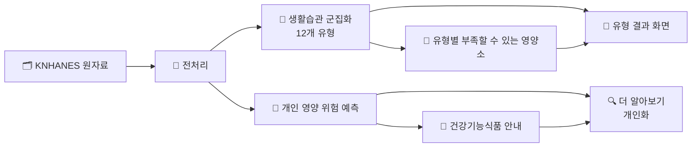
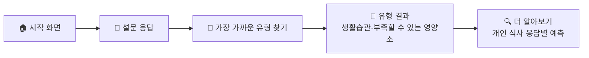

<div align="center">

# 🥗 NBTI 유형 검사

### 생활습관으로 알아보는 나의 영양 유형 · Nutrient + MBTI

<br>


<br>

[프로젝트 소개](#-프로젝트-소개) · [일정](#-일정) · [진행 상황](#-진행-상황) · [팀원 소개](#-팀원-소개) · [폴더 구조](#-폴더-구조)

</div>

<br>

## 📌 프로젝트 소개

국민건강영양조사(KNHANES) 2022–2024 성인 **15,062명**의 생활습관을 머신러닝으로 유형화하고, 유형별로 부족하기 쉬운 영양소를 안내합니다. 개인별 영양 위험과 건강기능식품 안내는 개인화 단계에서 따로 합니다.

| 구분 | 목적 | 내용 |
| :---: | :---: | --- |
| 📊 **머신러닝 데이터 분석** | 발표 중심 | 생활습관 군집화(K-Medoids, 대분류 4 × 세부 3 = 12개 유형), 영양소 부족 위험 예측 모델, 유형별 부족할 수 있는 영양소, 제품 자료 |
| 📱 **NBTI 유형 검사 웹앱** | 결과물 시연 | 휴대폰으로 생활습관 설문에 답하면, 미리 분석해 둔 12개 유형 중 가장 가까운 유형과 생활습관 신호등, 그 유형에서 부족할 수 있는 영양소를 보여줍니다. |

> 학습은 오프라인에서 수행합니다. 웹은 브라우저에서 고정된 중심값으로 유형을 배정하고, 개인 단계에서는 학습된 모델로 응답별 예측을 계산합니다. 제품 정보는 별도 표시 자료입니다.
> 결과는 참고용이며 의료적 진단이나 처방을 대체하지 않습니다.





<br>

## 🗓 일정

| 날짜 | 내용 |
| :---: | --- |
| 10.29 (목) | 🚀 프로젝트 시작 |
| 10.30 (금) | 📝 주제 선정 마감 |
| 11.03 (화) | 🧩 최종 12개 유형·유형 이름 확정, 데이터명세서 제품 항목 추가 |
| 11.04 (수) | 💊 가격 조사 1차 완성, 웹 결과표 12개 유형 연결 |
| **11.09 (월) 18:00** | 🔥 **발표자료 및 보고서 제출 마감** |
| 11.10 (화) | 🏁 프로젝트 종료 |

<br>

## ✅ 진행 상황

### 📊 데이터 분석
- [x] 데이터 수집 및 전처리 (KNHANES 2022–2024, 성인 15,062명)
- [x] 영양소 부족 위험 예측 모델 (서비스용 설문 변수만 사용, 평균 AUC 0.665)
- [x] 생활습관 군집화 (K-Medoids 대분류 4 × 세부 3 = 12개 유형)
- [x] 군집 검증·보완 (대안 비교, 규칙 대조군, 경계 분석) 및 12개 유형 이름 확정 → [군집화 결론](bigskyyang/analysis/군집화_결론.md)
- [x] 유형별 부족할 수 있는 영양소 ((나)안, 2024 검증)
- [ ] 개인 예측 모델 설문 변환 확인 (끼니·외식 값 방향)
- [ ] 제품 가격 조사

### 📱 웹앱
- [x] 시작 화면
- [x] 설문 화면 (한 문항씩, 드래그 선택, 휴대폰 뒤로가기 지원)
- [x] 결과 화면 (내 유형, 생활습관 신호, 정신건강·대사질환 선택 문항 안내)
- [x] 카카오톡 공유 미리보기, Vercel 배포
- [x] 12개 유형 모델 연결, 유형별 마스코트·이름
- [x] 유형별 부족할 수 있는 영양소 연결
- [x] 선택형 습관 점수 비교
- [ ] 더 알아보기 (개인 예측 모델·mini-FFQ·안전 문항)

<br>

## 👥 팀원 소개

| 사진 | 이름 | GitHub | 역할 | 한 마디 |
| :---: | :---: | :---: | --- | --- |
|  | 양대천<br>(팀장) | [@BigskyYang](https://github.com/BigskyYang) | 팀장, 웹앱 개발, 레포 관리, 기획서 | 모르는 건 편하게 물어보세요! |
|  | 박준혁 | [@junhyeok-1](https://github.com/junhyeok-1) | 제품분석 (영양제 제품 조사·큐레이션, 가격 조사) | 열심히 하겠습니다.! |
|  | 전유환 | [@wjsdbghks2-eng](https://github.com/wjsdbghks2-eng) | 제품분석 (유형별 영양 니즈, 제품 추천 코드, 웹 결과표 연동) | 열심히 하겠습니다.! |
|  | 최지연 | [@jyjy8940](https://github.com/jyjy8940) | 생활습관 군집화 (K-Medoids 12개 유형, 유형 이름) | 맛있는 거 먹으면서 파이팅! |
|  | 황재준 | [@hwangjj3510](https://github.com/hwangjj3510) | 데이터 전처리, 영양소 부족 예측 모델, 설문 문항 | 열심히 하겠습니다! |

<br>

## 📁 폴더 구조

각자 **자기 이름 폴더** 안에서 작업합니다.

```
.
├── 📂 bigskyyang/      # 양대천 · 웹앱
│   ├── web/            #   NBTI 유형 검사 웹앱 (Vite + React)
│   ├── analysis/       #   군집화 검증·보완, 웹용 12개 유형 모델
│   └── scripts/        #   분석 결과 → 웹용 데이터 변환
├── 📂 junhyeok/        # 박준혁 · 영양제품 자료 안내 (데이터는 구글 드라이브)
├── 📂 Yuhwan/          # 전유환 · 제품분석
│   ├── 영양분석/       #   유형별 영양 니즈, 웹 결과표용 내보내기
│   ├── 제품분석/       #   제품 전처리·군집·추천
│   └── 팀공유/         #   팀원 확인 요청, 가격 조사 양식
├── 📂 Jiyeon/          # 최지연 · 생활습관 군집화 (K-Medoids)
├── 📂 Jaejun/          # 황재준 · 전처리, 영양소 부족 예측 모델, 설문 문항
├── 📂 docs/            # 프로젝트 기획서, 일일 진행 일지
└── 📄 README.md
```

<br>

## ⚠️ 주의할 점

- 작업 시작 전에는 항상 **Pull origin** 먼저
- **내 이름 폴더 안에서만** 작업 (다른 사람 폴더는 건드리지 않기)
- 커밋했으면 쌓아두지 말고 **바로 Push**
- 빈 폴더는 올라가지 않으니 **파일을 하나 이상** 넣기
- 100MB가 넘는 파일은 GitHub에 올라가지 않으니 구글 드라이브나 Quick Share 사용
- 개인정보, API 키, 비밀번호가 담긴 파일은 올리지 않기
- **국민건강영양조사 원자료와 개인별 결과(`.csv`, `.xlsx`)는 올리지 않기** (공개 레포라서 `.gitignore`로 막아 둠, 공유는 구글 드라이브로)
- 충돌(conflict) 메시지가 뜨면 아무것도 누르지 말고 팀 채팅방에 공유
