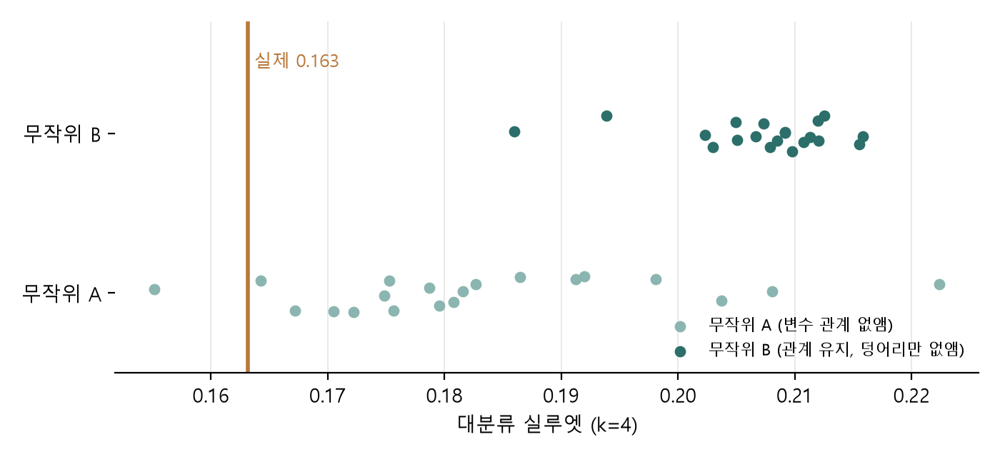

# 군집 귀무 검정 결과 + 프로젝트 강점·약점·보완할 점·한계 (11/4, 전유환)

> 범위: 생활습관 군집(12유형) + 유형별 부족 영양소. 개인 맞춤 예측·영양제 안내는 제외.
> 숫자는 모두 코드 실행 값입니다. 군집 부분은 지연님 코드 함수를 그대로 불러 계산했으니 지연님 확인 부탁드려요 🙏

## 1. 군집 귀무 검정: 실루엣 0.163이 '구조 없는 자료'보다 높은가

**질문**: 대분류 실루엣 0.163은 낮은 값인데, 덩어리가 전혀 없는 자료에서도 이 정도가 나오는가?

**방법** (`영양분석/15_군집_귀무검정.py`)
- 지연님 `kmedoids_final.py`의 `build_matrix`·`kmedoids`·`silhouette`를 그대로 불러 같은 절차(7변수 → PCA 5 → k-medoids k=4, n_init=10)를 반복. 실제 자료로 실루엣 **0.163 재현** 확인
- 무작위 A (변수 관계 없앰): 7변수를 각각 따로 섞음 → 변수별 분포는 같고 변수 사이 관계만 없음
- 무작위 B (관계 유지, 덩어리만 없앰): 가우시안 코퓰라 → 변수별 분포(이산값 포함)와 순위상관은 같고, 덩어리만 없음
- 각 20회

**판정 기준 (결과 보기 전에 확정)**
| 결과 | 판정 |
|---|---|
| A·B 20회 최댓값을 모두 넘음 | 우연보다 뚜렷한 구조 |
| A만 넘음 | 변수 간 관계에서 오는 구조, 따로 떨어진 덩어리는 아님 |
| 둘 다 못 넘음 | 연속 분포를 나눈 구분 |

**결과**
| 자료 (20회) | 실루엣 평균 | 범위 | 실제(0.163)보다 높은 횟수 |
|---|---|---|---|
| 무작위 A | 0.183 | 0.155 ~ 0.222 | 19 / 20 |
| 무작위 B | 0.207 | 0.186 ~ 0.216 | 20 / 20 |

**판정: 연속 분포를 나눈 구분**
- 생활습관은 서로 떨어진 무리로 나뉘지 않고 이어진 분포입니다. 팀장님 `군집화_결론.md`의 "연속적인 생활습관을 이해하기 쉽게 나눈 구분" 표현이 맞다는 확인입니다.
- 무작위 자료가 더 높게 나온 이유는 따로 확인하지 않았습니다 (값이 몇 개뿐인 변수 때문일 가능성은 추측). 이유와 상관없이 **이 자료에서 실루엣은 '구조가 있다'는 근거로 쓰지 않는 것이 맞습니다.**
- 유형의 가치는 실루엣 대신 아래로 설명할 것을 제안합니다:
  - 안정성: 재현성 ARI 0.945, 웹 재배정 일치율 100%
  - 쓸모: 성별·연령 기준 모델 대비 15개 중 13개 영양소에서 유의하게 개선, 2024년 관측/기대 비 1.087
  - 경계 고객도 비슷: 유형 핵심 고객과 경계 고객의 2024 AUC가 비슷 (예: 철 0.706 / 0.668, 단백질 0.655 / 0.650)
- 발표용 한 문장: **"생활습관은 이어진 분포라 뚜렷한 무리는 없지만, 12유형은 안정적으로 다시 나오고 부족 영양소 안내에 쓸모 있는 구분입니다."**

## 2. 강점
1. **기준을 먼저 정하고 결과를 봄**: 표시 규칙(부족 확률 0.5 / 1.2배 / 0.3)과 판정 기준을 결과 전에 확정
2. **시간 분할 검증**: 2022–23 학습 → 2024 확인. 유형 영역 항목의 2024 관측/기대 비 1.087 [1.056, 1.121]. 판정이 강할수록 높음 (유형 고유 1.36 > 식사량 관련 1.24 > 성별·연령 공통 1.04)
3. **비교 대상이 있음**: 성별·연령 기준 모델 대비 ΔAUC +0.014~0.040, 15개 중 13개 유의
4. **확률이 정확함**: 보정 오차 ≤ 1.7%p → "10명 중 N명"을 그대로 보여 줘도 됨
5. **안정적**: 군집 ARI 0.945, 민감도 분석(평소 식사일·에너지 범위) 안내 일치율 98.7~99.4%, 식사 요일에 따른 부족률 차이 작음
6. **흐름이 이어짐**: 유형 → 부족 영양소 → 바꿀 습관 (습관 연결표)
7. **표현을 조심함**: 진단·처방·인과 표현 없음, 근거가 약한 비타민 D·E·칼륨은 공통 안내로만

## 3. 약점 (손볼 수 있는 것)
1. **유형이 더해 주는 정보가 작음**: ΔAUC 최대 0.040, AUC 0.56~0.70. 부족 여부는 대부분 성별·나이와 개인차로 정해짐
2. **군집에 뚜렷한 무리가 없음**: 위 귀무 검정
3. **습관 연결표는 식사량 영향이 큼**: 끼니를 거르면 덜 먹어서 부족해지는 당연한 결과에 가까움. 외식 잦음은 반대 방향(외식 잦은 쪽이 단백질 부족 10명 중 0.5명 적음)
4. **수면 불규칙은 2024년 자료만 가능**: 잠드는 시각을 2024년에만 물어서, 인원 적은 조합이 40%
5. **인원 적음 기준(30명)은 임시 값**: (나)안에는 인원 기준이 없어서 정한 값, 팀장님 확인 대기

## 4. 보완할 점
| 약점 | 보완 | 상태 |
|---|---|---|
| 유형 효과가 작음 | 숨기지 말고 결론으로: "유형은 출발점, 정확한 판단은 개인 맞춤 단계" → 서비스 2단계 구조의 근거 | 보고서 반영 예정 |
| AUC가 낮음 | 정답(부족 여부)이 하루 기록이라 흔들리면 AUC가 낮게 나옴 → 낮은 AUC의 이유 중 하나로 설명 | 보고서 반영 예정 |
| 덩어리 없음 | 귀무 검정 결과를 싣고, 유형의 가치는 안정성·쓸모·경계 AUC로 설명 | 지연님 확인 필요 |
| 식사량 영향 | 미션 문구를 "끼니 챙기기가 먼저"로, 외식은 영양소 근거로 쓰지 않음 | 팀장님 결정 대기 |
| 수면·인원 기준 | 인원 적은 조합을 숨길지 "자료가 적어요"로 표시할지 | 팀장님 결정 대기 |

## 5. 한계 (데이터·방법상 바꿀 수 없는 것)
1. **하루 식사 기록뿐**: 제9기(2022–24)는 하루 24시간 회상만 있어 부족률이 평소 섭취 기준보다 크게 나올 수 있음
   - 연도를 쌓아도 해결 안 됨 (해마다 다른 사람을 조사)
   - 식사 요일은 확인했지만 차이가 작음 (일요일 식사 기록 마그네슘 50.3% vs 평일 47.8~48.4%)
   - 회귀 예측값으로 바꾸면 개인차까지 지워져 범위가 너무 넓음 (단백질 1.7~22%, 칼슘 71~100%)
   - 다만 유형과 같은 성별·나이를 **비교**하는 결론은 이 흔들림에 덜 영향을 받음 (흔들림은 차이를 작게 보이게 함)
2. **영양제 섭취 미포함**: 음식만 계산
3. **충분섭취량(AI) 기준 4개는 참고 지표**: 비타민 D·E·칼륨·식이섬유는 기준 미만이라고 부족하다고 단정할 수 없음
4. **상관관계**: 습관과 부족의 원인·효과는 말할 수 없음
5. **자기 보고**: 설문 응답과 식사 기억에 의존
6. **공개 자료의 제약**: 조사 날짜(계절)는 학술연구용 자료에만 있어 확인하지 못함
